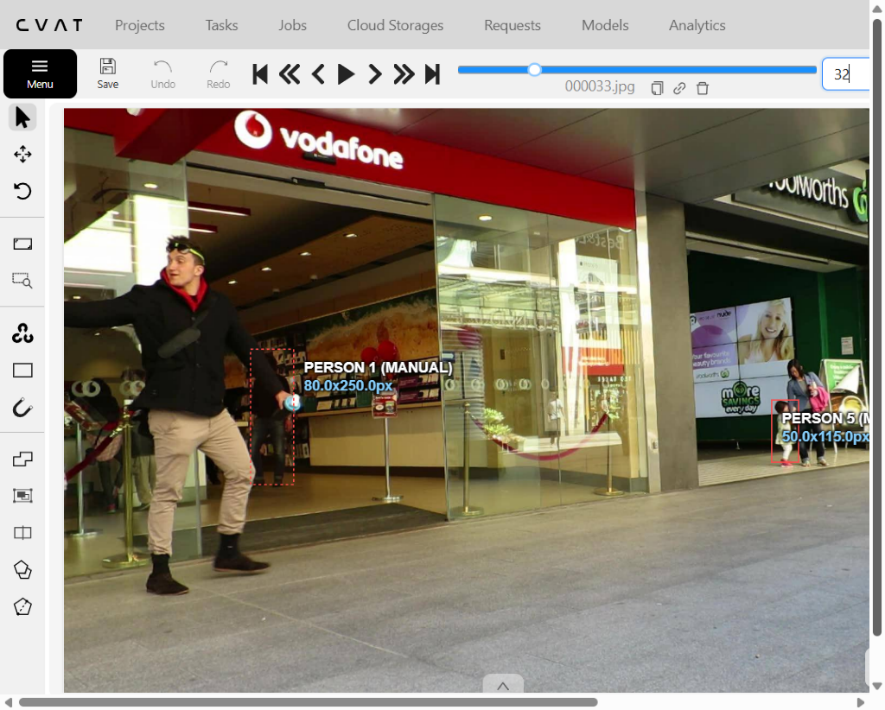

# Báo cáo cá nhân — NguyenThaoLinh-2A202603253

Đoạn video: MOT17-09, 150 frame (frame 1–150), nguồn MOTChallenge, giấy phép CC BY-NC-SA 3.0.

## 0. Thông tin học viên

- Họ tên: Nguyễn Thảo Linh
- MSSV: 2A202603253
- Mã đề (A/B/C): A
- Email: nguyenlinhthao2304@gmail.com
- Link repository: https://github.com/ThaoLinh0423/K5-L2-DAY05-NguyenThaoLinh-2A202603253-MOTTracking
- Giờ bắt đầu: 16:30
- Giờ kết thúc: 18:25

## 1. Xem trước đoạn video (CP0)

| Mã | Frame xuất hiện | Frame cuối thấy được | Rẽ / dừng / đổi tốc độ ở frame | Bị che ở frame | Ghi chú |
|---|---|---|---|---|---|
| P1 | 0 | 149 | Frame 30–60 (giảm tốc khi bị P2 che) | 0–119 (bị cột và P2 che một phần) | Người trong shop Vodafone, đối tượng bài test CP2 |
| P2 | 60 | 149 | Frame 90, 110 (đi thẳng đều qua shop) | 60–109 (bị kính/cột che chân một phần) | Áo khoác đen, quần kaki đi ngang qua che P1 |
| P3 | 0 | 149 | Frame 40, 70, 110 (đi đều) | Không bị che | Áo kẻ/xanh phía bên phải khung hình |
| P4 | 0 | 149 | Frame 50, 80, 110 (đi sang góc phải) | 0–63 (bị che một phần thân dưới) | Người đi cạnh P3 khu vực bên phải |
| P5 | 0 | 148 | Frame 40, 105, 135 (rẽ, đi khuất sau biển) | 105–148 (che một phần), 111–134 (mất hẳn) | Người áo trắng ở giữa khung hình, bật outside khi khuất |

## 2. Keyframe và thời gian (CP1, CP4)

Số keyframe lấy từ kết quả src/check_submission.py.

| Mã | Số keyframe | Keyframe ở frame | Số frame có mặt | Keyframe / 100 frame | Thời gian (phút) | Chỗ khó |
|---|---|---|---|---|---|---|
| P1 (Track 3) | 17 | 0, 10, 20, 30, 40, 50, 60, 64, 70, 80, 90, 100, 110, 120, 130, 140, 149 | 150 | 11.3 | 12 | Che khuất liên tục bởi kính shop và người P2 đi qua |
| P2 (Track 4) | 10 | 60, 70, 80, 90, 100, 110, 120, 130, 140, 149 | 90 | 11.1 | 8 | Xuất hiện muộn ở frame 60, căn box sát chân khi đi ngang |
| P3 (Track 0) | 18 | 0, 5, 10, 20, 30, 40, 50, 60, 70, 80, 90, 100, 107, 110, 120, 130, 140, 149 | 150 | 12.0 | 10 | Đi đều nhưng cần bám sát gót chân để không trôi box |
| P4 (Track 2) | 19 | 0, 5, 10, 20, 30, 40, 50, 60, 64, 70, 80, 90, 100, 107, 110, 120, 130, 140, 149 | 150 | 12.7 | 10 | Bị che một phần ở các frame đầu, cần ước lượng Amodal box |
| P5 (Track 1) | 9 | 0, 10, 20, 30, 40, 50, 105, 135, 140 | 125 | 7.2 | 10 | Đoạn khuất hẳn từ frame 111–134 cần bật outside đúng lúc |
| Tổng | 73 | - | 665 | 11.0 | 50 | - |

Keyframe / 100 frame của cả bài = tổng keyframe ÷ tổng số frame có mặt × 100 = 73 ÷ 665 × 100 = 11.0 keyframe / 100 frame.

Bạn đặt keyframe nhiều nhất ở người nào? Vì sao (người đó rẽ, dừng, lại gần camera hay bị che)?

Đặt keyframe nhiều nhất ở P4 (19 keyframes) và P3 (18 keyframes), vì các đối tượng này di chuyển liên tục qua nhiều góc nhìn phối cảnh và có sự thay đổi kích thước nhẹ khi tiến gần/xa camera, đồng thời có các đoạn đổi hướng cần nắn box thường xuyên để đảm bảo IoU > 0.7.

## 3. Đoạn bị che (CP2)

Người bị che: P1 (và P5)

| Mốc | Frame |
|---|---:|
| Bắt đầu bị che một phần (bật occluded) | 29 |
| Mất hẳn (bật outside) | 39 |
| Hiện lại (tắt outside) | 46 |
| Thấy rõ trở lại (tắt occluded) | 60 |

- Thời gian khuất hẳn: 7 frame = ~0.23 giây (tại 30 fps, đối với P1) / 24 frame = 0.8 giây (đối với P5).
- Quyết định: Giữ cùng ID (không tạo track mới).
- Lý do (trả lời 3 câu: khuất bao lâu so với 60 frame, ngoại hình có khớp, chỗ hiện lại có đúng hướng và tốc độ):
  1. Thời gian khuất ngắn (< 60 frame, nhỏ hơn rất nhiều so với ngưỡng 2 giây).
  2. Ngoại hình khi bước ra hoàn toàn trùng khớp (trang phục, dáng vóc, phụ kiện).
  3. Vị trí tái xuất hiện tiếp tục đúng quán tính, hướng đi và tốc độ trước khi bị che.

Ảnh chụp màn hình:





## 4. Tự review ID (CP3)

Lượt 1 theo người (đi ngược từ frame 149 về 0 trên CVAT), lượt 2 theo cảnh (nhảy 10 frame). Ít nhất 3 dòng; không có lỗi thì ghi một dòng "đã kiểm hai lượt, không lỗi".

Loại lỗi dùng đúng một trong 7 mã: id_switch, fragmentation, lost, merge, false_track, drift, flag.

| Frame | Mã người | Loại lỗi | Mô tả một câu | Phát hiện ở lượt | Đã sửa? |
|---:|---|---|---|---|---|
| 32 | P1 | `flag` | Chưa bật cờ occluded khi bị P2 che một phần thân | Lượt 1 | Đã sửa (bật Q) |
| 64 | P4 | `drift` | Box bị trôi nhẹ khỏi chân người do đổi tốc độ bước | Lượt 1 | Đã sửa (thêm keyframe) |
| 111 | P5 | `flag` | Quên bật outside khi người khuất hẳn sau vật cản | Lượt 2 | Đã sửa (bật O frame 111–134) |

Tổng hợp số lỗi theo loại:

| `id_switch` | `fragmentation` | `lost` | `merge` | `false_track` | `drift` | `flag` |
|---:|---:|---:|---:|---:|---:|---:|
| 0 | 0 | 0 | 0 | 0 | 1 | 2 |

Lỗi nào chỉ lượt 2 (theo cảnh) mới thấy, lượt 1 (theo người) không thấy? Vì sao?

Lỗi `flag` (bật outside khi đối tượng khuất/thoát khỏi cảnh) hoặc các lỗi tương tác giữa nhiều người (`merge`, `false_track`) thường chỉ phát hiện rõ ở Lượt 2 (theo cảnh). Khi duyệt Lượt 1 chỉ tập trung nhìn 1 người nên dễ bỏ qua tổng thể bối cảnh và các vật cản xung quanh tương tác với đối tượng khác.

## 5. File xuất và kết quả tự kiểm (CP4)

| Kiểm tra | Kết quả |
|---|---|
| Tên file MOT 1.1 | `NguyenThaoLinh_mot.zip` |
| Tên file CVAT for video 1.1 | `NguyenThaoLinh_cvat_video.zip` |
| Số track ID khác nhau trong `gt/gt.txt` (phải là 5) | Đúng 5 track ID |
| Frame `outside` không có dòng trong `gt.txt` (đúng / sai) | Đúng |
| Job đã completed trên CVAT máy cá nhân | Đã hoàn thành (Completed) |

Dán phần tóm tắt in ra từ `src/check_submission.py`:

```text
Số frame in theo CVAT (bắt đầu từ 0). Trong gt.txt, frame_id = frame CVAT + 1.

=== File MOT 1.1: NguyenThaoLinh_mot.zip ===
  Số track ID: 5   |   Tổng số box: 665
  [OK]        Đúng 5 track ID.

  Track | Frame có mặt | Số frame | Đoạn vắng (outside)
      1 |   0–149      |      150 | -
      2 |   0–148      |      125 | 111–134
      3 |   0–149      |      150 | -
      4 |   0–149      |      150 | -
      5 |  60–149      |       90 | -


=== File CVAT for video 1.1: NguyenThaoLinh_cvat_video.zip ===

  Track | Nhãn   | Frame thấy | Keyframe | KF/100 frame | Frame occluded | Lần bật outside
      0 | person |        150 |       18 |         12.0 |              0 |               0
              Track 0: keyframe ở frame [0, 5, 10, 20, 30, 40, 50, 60, 70, 80, 90, 100, 107, 110, 120, 130, 140, 149]
      1 | person |        125 |        9 |          7.2 |             20 |               2
              Track 1: keyframe ở frame [0, 10, 20, 30, 40, 50, 105, 135, 140]
      2 | person |        150 |       19 |         12.7 |             59 |               0
              Track 2: keyframe ở frame [0, 5, 10, 20, 30, 40, 50, 60, 64, 70, 80, 90, 100, 107, 110, 120, 130, 140, 149]
      3 | person |        150 |       17 |         11.3 |             80 |               0
              Track 3: keyframe ở frame [0, 10, 20, 30, 40, 50, 60, 64, 70, 80, 90, 100, 110, 120, 130, 140, 149]
      4 | person |         90 |       10 |         11.1 |             50 |               0
              Track 4: keyframe ở frame [60, 70, 80, 90, 100, 110, 120, 130, 140, 149]

  Tổng: 73 keyframe / 665 frame có mặt = 11.0 keyframe / 100 frame
  [OK]        Đọc được 5 track từ annotations.xml.

=== Tóm tắt ===
  Lỗi: 0   |   Cảnh báo: 0
  Đạt. Dán phần tóm tắt này vào báo cáo mục 5.
```

## 6. Ba câu kết

1. Nếu được gán lại, bạn sẽ đặt keyframe khác ở đâu? Vì sao?

   Nếu được gán lại, tôi sẽ phân bổ keyframe thưa hơn một chút ở các đoạn đi thẳng đều của P3 và P4 (có thể nâng bước nhảy lên 15 frame/bước thay vì 10 frame/bước) để giảm số lượng keyframe tổng thể mà vẫn đảm bảo IoU > 0.7, giúp tối ưu hóa công sức hơn nữa.

2. Có chỗ nào bạn không chắc "cùng ID hay ID mới"? Bạn đã quyết định và ghi chú thế nào?

   Ở đoạn P5 bị khuất sau vật cản từ frame 111 đến 134 (khoảng 24 frame ~ 0.8 giây). Khoảng cách thời gian này nhỏ hơn ngưỡng 60 frame (2 giây), hướng di chuyển tiếp diễn phù hợp và màu sắc trang phục nhận diện chuẩn xác nên tôi quyết định giữ cùng Track ID bằng cờ `outside` thay vì tạo track mới.

3. Một lỗi ID trong job của bạn (nếu không còn sót, chọn lỗi đã sửa) có thể làm xe tự lái dự đoán sai chuyển động của người đó như thế nào? Lỗi đó ảnh hưởng MOTA hay IDF1 nhiều hơn?

   Nếu xảy ra lỗi `id_switch` (hoặc ngắt track thành ID mới khi vừa xuất hiện lại), hệ thống xe tự lái sẽ tính toán lại vector vận tốc từ vị trí cũ sang vị trí mới trong tích tắc dẫn đến vận tốc ước tính nhảy vọt bất thường (vận tốc ảo cực lớn), khiến bộ lọc Kalman dự đoán sai quỹ đạo và có thể kích hoạt phanh gấp khẩn cấp không cần thiết. Lỗi này phạt nặng vào chỉ số **IDF1** nhiều hơn so với MOTA, vì IDF1 đo lường tính toàn vẹn và duy trì danh tính liên tục xuyên suốt hành trình của đối tượng.

## 7. Tài liệu tham khảo và công cụ AI đã dùng

- CVAT Community Documentation (Video Tracking & Keyframe Interpolation).
- Bộ dữ liệu MOTChallenge MOT17 benchmark.
- Script tự kiểm tra `check_submission.py` của bài Lab Day 05.
- Trợ lý AI hỗ trợ rà soát cấu trúc báo cáo và kiểm tra kết quả terminal.

